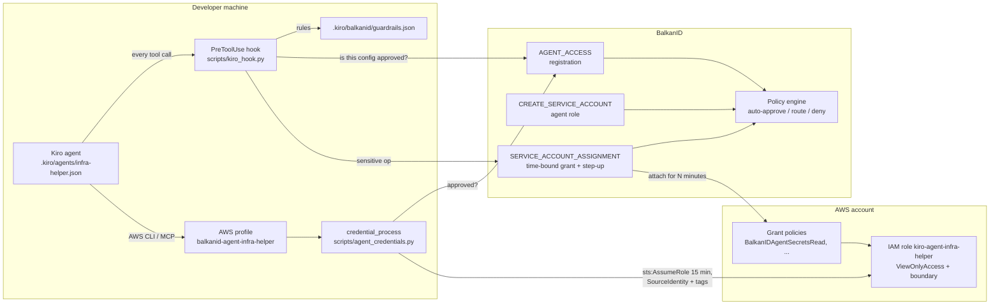

# Architecture: BalkanID guardrails for Kiro agents

## Problem

A Kiro custom agent runs on the developer's machine with the developer's environment. When it calls the AWS CLI or an AWS MCP server, it uses whatever credentials the developer has loaded. In practice that means every agent a developer instantiates inherits that developer's full permissions, has no named owner, no approval, and no expiry. A prompt-injected or simply over-eager agent then acts with developer-level privilege.

## Design principles

1. **The agent is its own identity.** It never uses the developer's credentials. It gets a dedicated IAM role, approved in BalkanID, and receives credentials only for that role.
2. **Approve the exact config.** BalkanID approves a SHA-256 fingerprint of `.kiro/agents/<name>.json`. Adding a tool, an MCP server or loosening a permission rule invalidates the approval.
3. **Least privilege by default, more only on request.** The role starts with view-only access. Secrets, production and customer data are time-bound grants that a human approves, with step-up MFA on sensitive entities.
4. **Fail closed.** Unregistered, changed, denied or unverifiable agents cannot run tools.
5. **Ephemeral credentials.** Every credential set lasts 15 minutes by default and is deleted when the session ends.
6. **Defense in depth.** Client-side hooks give fast, explainable decisions. The IAM role and permissions boundary enforce the same limits in AWS, where a hook cannot be bypassed.

## Components



| Piece | File | What it does |
|---|---|---|
| Agent config | `.kiro/agents/<name>.json` | Kiro custom agent. Must carry the three BalkanID hooks, deny `~/.aws/**`, and point AWS MCP servers at the agent profile. `register_agent.py --lint-only` enforces this. |
| Registration | `scripts/register_agent.py` | `createRequest` with `AGENT_ACCESS`, owner, purpose, intended role ARN and a metadata summary (tools, MCP servers, hooks, fingerprint, parent). Waits for approval; fails closed. An approval only counts if the request is `AGENT_ACCESS` and its metadata carries this exact config fingerprint, so a request id cannot be borrowed from another request or an older config. |
| Agent role | `scripts/service_account_gate.py`, `terraform/agent-role` | `CREATE_SERVICE_ACCOUNT` approval, then Terraform creates `kiro-agent-<name>` under `/balkanid-kiro-agents/` with a permissions boundary. Only listed developer roles may assume it, and only with a SourceIdentity and the agent's session tags. |
| Profile link | `scripts/setup_agent_profile.py` | Records the role ARN and BalkanID service account id, and writes the `credential_process` profile. |
| Credentials | `scripts/agent_credentials.py` | Re-checks the approval, refuses any role other than `role/balkanid-kiro-agents/kiro-agent-<name>`, then assumes it for 15 minutes. Caches until near expiry. |
| Guardrails | `scripts/kiro_hook.py`, `scripts/guardrails.py`, `.kiro/balkanid/guardrails.json` | Runs on SessionStart, every PreToolUse and SessionEnd. |
| Grant policies | `terraform/grant-policies` | Account-wide policies BalkanID attaches for an approved grant window. |
| PR gate | `.github/workflows/agent-approval.yml` | Required check: a changed agent config merges only with a live, matching approval. |

## Control flows

### 1. Creating an agent

1. A developer writes `.kiro/agents/<name>.json` with the BalkanID hooks.
2. `register_agent.py` lints it, fingerprints it, and raises an `AGENT_ACCESS` request naming the human owner. BalkanID request policies decide: auto-approve, route to a named approver, or auto-deny, based on conditions such as the request type, the owner's department or the integration.
3. On approval, the request id and fingerprint are written to `.kiro/balkanid/registrations.json`. The developer commits both files; the `Agent approval` check re-verifies the approval live before merge.
4. `service_account_gate.py` raises `CREATE_SERVICE_ACCOUNT` for the agent role. On approval, Terraform creates the role, `trigger_sync.py` lets BalkanID discover it, and `setup_agent_profile.py` links it.

### 2. Every tool call (PreToolUse)

```
hook input unreadable (empty, not JSON, no tool_name)        -> block
registration missing / config changed / approval not live  -> block
approval not AGENT_ACCESS for this exact fingerprint        -> block
deny rule matches                                          -> block (auto-deny)
any AWS CLI call in a shell command without its own
  --profile balkanid-agent-<name> (checked per segment)     -> block (own identity only)
subagent not registered as this agent's child              -> block
sensitive rule matches:
    approved, inside its window (from request creation)    -> allow
    pending                                                -> block, "waiting on <id>"
    denied or missing                                      -> block; never re-asked until the
                                                              owner runs kiro_hook.py clear-grant
    no request, or the window has passed                   -> raise SERVICE_ACCOUNT_ASSIGNMENT
                                                              (grant policy, duration), block
otherwise                                                  -> allow
```

Each decision is appended to `~/.cache/balkanid-kiro/audit.jsonl` with the tool name, rule, request id and a hash of the input.

### 3. Sensitive access with step-up

The hook raises a `SERVICE_ACCOUNT_ASSIGNMENT` against the agent's own service account, granting the policy named in the rule (for example `BalkanIDAgentSecretsRead`) for `duration_seconds`. Mark those grant policies sensitive in BalkanID with a custom insight that has **Is Sensitive** enabled; approving the request then requires the approver to complete step-up MFA. If BalkanID requires step-up from the requester too, `createRequest` returns `stepUpRequired` and the hook tells the agent to stop and ask the human.

### 4. Subagents

Register a child with `register_agent.py --agent <child> --parent <parent>` and apply `terraform/agent-role` with `parent_agent_name`. The child gets its own role, but shares the parent's permissions boundary, so it can never exceed its parent. The parent's hook only allows `subagent`, `use_subagent` and `delegate` calls whose agent name field exactly matches a registered child.

### 5. Ending a session

`SessionEnd` deletes the cached credentials. Kiro fires `SessionEnd` in the CLI; in the IDE, rely on the 15 minute STS lifetime. Anything left behind expires with its STS session. Grants expire with their BalkanID duration.

## Threat model

| Threat | Control | Where it is enforced |
|---|---|---|
| Agent uses the developer's AWS credentials | Agent profile only; `~/.aws/**` denied; `aws configure export-credentials`, `sts get-session-token` and raw key env vars denied; AWS CLI without the agent profile denied | Hook and Kiro permissions. Server side, the agent role is the only thing BalkanID issues. |
| Agent escalates privilege | IAM, Organizations, SSO and `sts:AssumeRole` denied by hook and by the permissions boundary | Both. The boundary holds even if a hook is bypassed. |
| Agent reads secrets or customer data | Not in ViewOnlyAccess; only via a time-bound, step-up approved grant | IAM. The hook adds the request flow and a clear explanation. |
| Agent destroys data | Destructive commands denied; boundary denies deletes of buckets, tables, databases and keys | Both. |
| Someone widens the agent quietly | Config fingerprint bound to the approval; PR check run with base-branch scripts; agent cannot read or write `.kiro/**`, the guardrail scripts, `.env` or the credential cache | BalkanID approval plus branch protection. |
| Agent re-points its profile at a powerful role | `agent_credentials.py` only issues credentials for the agent's own role ARN pattern; `setup_agent_profile.py` refuses others | Hook process (not reachable by the agent) and IAM trust policy. |
| BalkanID unreachable | Use a recent approved status for up to `BALKANID_MAX_STALE_SECONDS`, then block | Hook. |
| Stolen agent credentials | 15 minute lifetime; SourceIdentity names the developer; session tags name the agent | AWS. CloudTrail attributes every call to agent and developer. |

**Limits.** Hooks run on the developer's machine, so a developer can disable them for their own session. That is a policy violation rather than a technical bypass of AWS controls: without the hook the agent still has only the agent role, and BalkanID still sees and reviews that role. Pattern rules inspect command text; they are a guardrail, not a sandbox. Treat the IAM role and boundary as the source of truth.

## Production considerations

- Replace pattern rules you rely on heavily with IAM conditions, and keep the boundary's service list short.
- Prefer webhooks (`request.actioned`) to resume work when approvals take hours.
- Distribute the hooks and `guardrails.json` through a managed repo template so every team starts governed.
- Review agent roles in BalkanID access review campaigns like any other service account.
